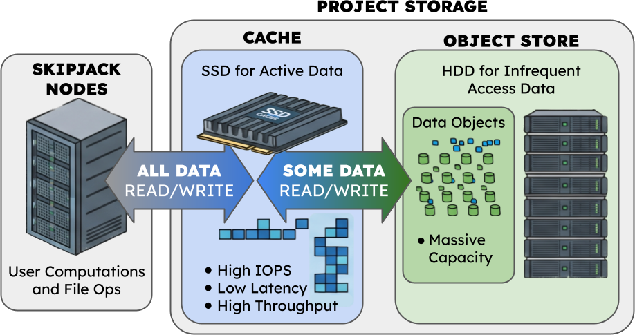

.. _skipjack storage:

########################
Skipjack Storage
########################

Skipjack has three places to keep files: your **home** directory, your group's **scratch** space, and your
group's **Project Storage**. All three are WEKA filesystems, available on the login nodes and on every compute
node.

.. warning::

   Rockfish filesystems (including ``/data`` and ``/scratch4`` / ``/scratch16``) are **not** mounted on Skipjack.
   Copy the data you need with Globus; see :ref:`Data Transfer with Globus`.

In the paths below, ``<PI>`` is your PI's username.

.. list-table::
   :header-rows: 1
   :widths: 16 24 22 10 28

   * - **Storage**
     - **Path**
     - **Quota**
     - **Cost**
     - **Use it for**
   * - Home
     - ``/home/jhu/$USER`` or ``/home/schmidt/$USER``
     - 100 GB per user
     - Free
     - Scripts, source code, small configuration files
   * - Scratch
     - ``/scratch/jhu/<PI>`` or ``/scratch/schmidt/<PI>``
     - Shared per PI group: 1 TB by default; more on request
     - Free
     - Working data for jobs
   * - Project Storage
     - ``/projects/<PI>``
     - Chosen by the PI, in whole TB
     - Paid
     - Space beyond the free allocation

Home
****

Every user has a home directory with a **100 GB** quota. The home quota cannot be increased; put larger data in
scratch or Project Storage.

Your home directory also contains links to your group's other storage, for example:

.. code-block:: text

   /home/jhu/$USER/scratch_<PI>   ->  /scratch/jhu/<PI>
   /home/jhu/$USER/projects_<PI>  ->  /projects/<PI>

Scratch
*******

Each PI receives scratch space with a **1 TB** quota when their account is upgraded to PI. The quota is shared by
everyone working under that PI, however many projects the PI has.

If your group needs more scratch space, email `arch@jhu.edu <mailto:arch@jhu.edu>`__ with a justification. For
large amounts of data, use Project Storage.

Project Storage
***************

Project Storage is space a PI pays for when the group needs more storage than is allowed in their ``/scratch/``
allocation. *It is not intended to be archival or backup storage.* A valid IO is required to request a
``/projects/`` directory, and only one ``/projects/`` directory is created per PI, shared across all of their
projects. Each member's home directory has a ``projects_<PI>`` link that points to it.

How it works
============

Project Storage works like a hybrid drive. It has two parts:

- **Cache:** fast flash storage in the WEKA filesystem, where new and recently used files live.
- **Object store (Dell ECS):** Dell Elastic Cloud Storage, a large-scale storage platform that WEKA moves files to
  when they haven't been used for a while. Your object store allocation can be much larger than your cache.

You see a single filesystem at ``/projects/<PI>``; WEKA decides where each file lives.

For example, say a PI has **50 TB** of Project Storage with a **10 TB** cache:

#. Files created in or copied into ``/projects/<PI>`` land on the cache first.
#. If a file goes **24 hours** without being accessed, WEKA copies it to Dell ECS. At this point it exists in both
   places.
#. WEKA removes a file from the cache, leaving it only on Dell ECS, after whichever comes first:

   - it goes unaccessed for **a week**, or
   - the cache fills up: WEKA makes room by removing the least recently used files first, copying them to Dell
     ECS if they aren't there yet.
#. If you open or otherwise use a file that is only on Dell ECS, WEKA automatically brings it back to the cache.

Throughout, the file stays visible at the same path; you never need to move files between the two yourself.

In this example the group can store up to the 50 TB it requested, with up to 10 TB of it on the cache at a time.
50 TB is not a limit: a PI can request as much Project Storage as the group needs. Choose a cache large enough to
hold the data your jobs work on in a typical week.

Cost
====

- **Project Storage (total):** $3.00 per TB per month. This is all of your space, and it includes the cache.
- **Cache:** $30 per TB per month, in addition to the total.

For the example above: 50 TB × $3.00 = $150, plus 10 TB × $30 = $300, for **$450 per month**.

Requesting Project Storage
==========================

The PI requests both amounts, in whole TB, from the project page in the portal; see
:ref:`Request Project Storage <request project storage>` in the user guide for the steps.

- A valid IO is required.
- **Project Storage** is the total capacity, and includes the cache.
- **Cache** must be at least 1 TB and can't be larger than the total. A PI's cache across all of their projects
  is limited to 10 TB; a request above that needs a justification and staff approval.
- Requests take effect after staff approval, and typically take 1–3 business days to provision.

VAST (Rockfish users)
*********************

The Rockfish VAST filesystem will be mounted on Skipjack at ``/vast/``, so groups with VAST space will reach the
same files from both clusters; nothing needs to be copied. **This is not available yet**; this page will be
updated when it is.

Moving Data
***********

- **Globus** is the recommended way to move large amounts of data to or from Skipjack, including from Rockfish.
  Project Storage has no separate Globus endpoint: use the **Homes** endpoint for your login type and open the
  ``projects_<PI>`` folder. See :ref:`Data Transfer with Globus`.
- For many small files, bundle them first (for example ``tar -czf mydata.tgz mydata/``); transfers of a few large
  files are much faster than many small ones.

What Data Is Allowed
********************

Data subject to restrictions, including but not limited to HIPAA, PHI or CUI, is **not permitted** on ARCH
systems. If your research involves an IRB and the data is de-identified, contact
`arch@jhu.edu <mailto:arch@jhu.edu>`__ before storing or processing any data.
